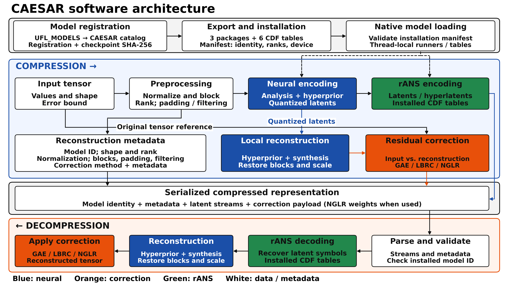

# CAESAR software architecture

The architecture figure replaces the earlier workflow diagram. It shows model
registration and installation, compression, local reconstruction, residual
correction, serialized metadata, and the corresponding decompression path.



{download}`Download the vector PDF <caesar_architecture.pdf>` ·
{download}`Download the editable SVG <caesar_architecture.svg>` ·
{download}`Download the Python generator <generate_architecture.py>`

Compression reads left to right, and decompression reads right to left. Enclosing
panels group each phase. Matching component colors show related operations:
blue for neural models, orange for correction, Gator Green (`#22884C`) for rANS,
and white for data and metadata. Blue (`#1B4FA8`) and orange (`#E8500A`) match
the README. Solid arrows show data and metadata; dashed arrows show installed
model dependencies. Both paths reuse the matching installation's packages and
probability tables.

The version-1 CAESAR serializer is implemented: `serialize`/`deserialize` preserve
all result fields in a buffer, while `save`/`load` provide single-file storage.
Registered model weights and entropy tables remain installed separately; trained
NGLR correction weights, when used, travel with the result. See
[the public API](public_api.md#saving-complete-results).

## Regenerate the figure

Install Matplotlib in your Python environment, then run from the repository root:

```sh
python3 docs/generate_architecture.py
```

The generator writes PDF, SVG, and an 18.5 × 10.5 inch PNG at 300 dpi
(5550 × 3150 pixels). All labels are bold; `font_scale` controls their sizes.
It checks box text for horizontal overflow and title/detail overlap.

## Include in the paper

Copy the PDF into the paper's `figures/` directory. With `graphicx` loaded,
use the full text width across both columns:

```latex
\begin{figure*}[t]
  \centering
  \includegraphics[width=\textwidth]{figures/caesar_architecture.pdf}
  \caption{CAESAR software architecture and workflow. Compression preprocesses
  the input tensor, performs neural encoding and rANS entropy coding, and uses
  a local reconstruction branch to generate residual corrections. Encoded
  streams, reconstruction metadata, and correction data form the compressed
  representation. Decompression verifies the model identity, decodes the
  streams, reconstructs the tensor, and applies the selected correction. Both
  paths reuse the installed model components and probability tables. Solid
  arrows show data and metadata; dashed arrows show installed dependencies.}
  \label{fig:caesar-architecture}
\end{figure*}
```

The figure summarizes component relationships rather than every execution branch.
Constant/filtered blocks can bypass neural coding. Input conversion currently
selects variable 0 for 5D tensors. The entropy-decoding block includes the
hyperprior operations needed to recover latent symbols. The CLI's legacy
three-file layout is distinct from the version-1 buffer and single-file API;
external ADIOS2 migration is tracked separately.
