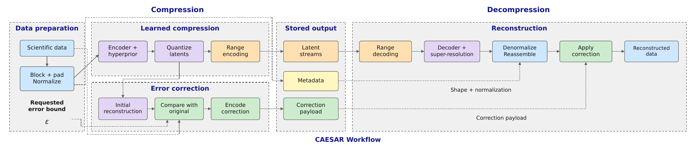

# CAESAR workflow

The figure follows scientific data through preparation, learned compression,
error correction, storage, and reconstruction.

{download}`Download the workflow figure as a PDF <caesar_workflow.pdf>`
